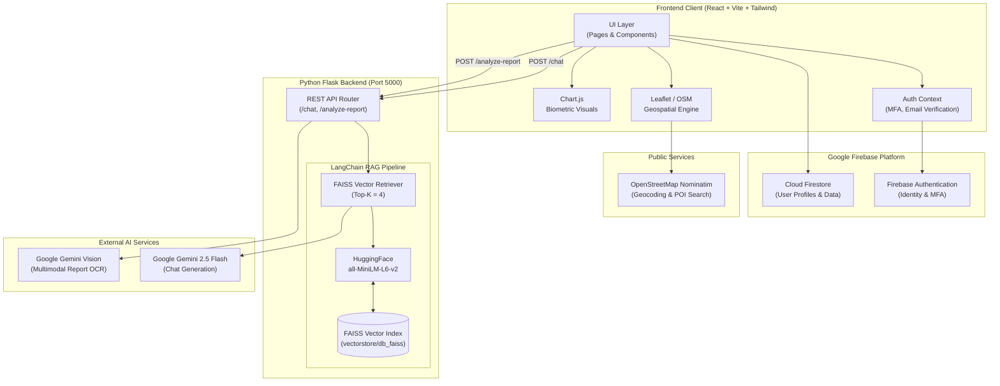

<div align="center">

# 🩺 CuraCore
### Enterprise-Grade AI Healthcare Assistant & Clinical Intelligence Platform

[](LICENSE)
[](https://www.python.org/)
[](https://nodejs.org/)
[](https://react.dev/)
[](https://vitejs.dev/)
[](https://www.langchain.com/)
[](https://aistudio.google.com/)
[](https://github.com/facebookresearch/faiss)
[](https://tailwindcss.com/)

<p align="center">
  <b>CuraCore</b> is a full-stack, production-ready AI healthcare assistant that bridges clinical data with actionable patient intelligence. Leveraging state-of-the-art <b>Retrieval-Augmented Generation (RAG)</b>, <b>Multimodal Computer Vision</b>, <b>Geospatial Mapping</b>, and <b>Interactive Biometric Telemetry</b>, CuraCore delivers reliable, verifiable medical guidance with zero fluff.
</p>

[Key Features](#-key-features) • [Architecture](#-system-architecture) • [Tech Stack](#-technology-stack) • [Quick Start](#-quick-start-guide) • [API Docs](#-api-reference) • [Configuration](#-configuration--environment-variables) • [Troubleshooting](#-troubleshooting) • [Disclaimer](#-medical--legal-disclaimer)

---

</div>

## 📑 Table of Contents

- [Overview](#-overview)
- [Key Features](#-key-features)
- [System Architecture](#-system-architecture)
- [Technology Stack](#-technology-stack)
- [Repository Structure](#-repository-structure)
- [Prerequisites](#-prerequisites)
- [Quick Start Guide](#-quick-start-guide)
  - [1. Clone Repository](#1-clone-the-repository)
  - [2. Backend Setup (Flask & RAG)](#2-backend-setup-medical_chatbot)
  - [3. Knowledge Base Ingestion](#3-ingest-medical-knowledge-base)
  - [4. Frontend Setup (React & Vite)](#4-frontend-setup-curacore-project)
  - [5. Launching Applications](#5-run-the-application)
- [Configuration & Environment Variables](#-configuration--environment-variables)
- [API Reference](#-api-reference)
  - [POST /chat](#post-chat)
  - [POST /analyze-report](#post-analyze-report)
- [Customizing the Knowledge Base](#-customizing-the-knowledge-base)
- [Security & Authentication](#-security--authentication)
- [Troubleshooting](#-troubleshooting)
- [Deployment Guide](#-deployment-guide)
- [Contributing](#-contributing)
- [Medical & Legal Disclaimer](#-medical--legal-disclaimer)
- [License](#-license)

---

## 🌟 Overview

Navigating complex healthcare records, laboratory diagnostics, and urgent medical queries can be overwhelming for patients and caregivers. **CuraCore** solves this by providing:

1. **Context-Grounded Answers:** Answers derived strictly from verified medical reference manuals using local FAISS vector search, minimizing model hallucinations.
2. **Multimodal Clinical Ingestion:** Direct parsing of physical laboratory reports, prescriptions, and radiology summaries via Gemini Vision.
3. **Preventive Health Metrics:** Interactive biometric assessment calculating Body Mass Index (BMI), Blood Pressure staging (AHA guidelines), and target heart rates.
4. **Geospatial Discovery:** Instant mapping of local hospitals, pharmacies, emergency rooms, and clinics using open-source OpenStreetMap and Leaflet geospatial queries without proprietary lock-in.

---

## 🚀 Key Features

### 1. 🤖 Context-Aware Medical RAG Assistant
- **Strict Evidence-Based Retrieval:** Employs LangChain and local vector embeddings (`sentence-transformers/all-MiniLM-L6-v2`) over curated medical corpora.
- **Anti-Hallucination Guardrails:** System prompts restrict the model from fabricating clinical claims or diagnosing beyond verified context.
- **Source Provenance:** Returns document metadata and reference sources with every answer for clinical auditability.

### 2. 🔬 Multimodal Medical Report Analyzer
- **Dual-Mode Input:** Accepts either pasted plain text reports or scanned image uploads (JPEG/PNG/WebP/PDF scan).
- **Vision-Powered OCR & Interpretation:** Leverages Google's multimodal Gemini architecture to extract unstructured values (e.g., hemoglobin, lipid profiles, thyroid panels).
- **Plain-Language Synthesis:** Translates dense medical jargon into structured, easy-to-digest summaries highlighting abnormal metrics and suggested non-prescriptive follow-ups.

### 3. 📊 Interactive Biometrics & Health Telemetry
- **Body Mass Index (BMI) Analytics:** Real-time classification into Underweight, Normal, Overweight, and Obese categories.
- **Cardiovascular Pressure Staging:** Evaluates systolic and diastolic blood pressure based on American Heart Association (AHA) benchmarks (Normal, Elevated, Stage 1, Stage 2, Crisis).
- **Interactive Visualizations:** Built-in charts powered by `Chart.js` visualizing health indices and metric progressions over time.

### 4. 🗺️ Geospatial Medical Facility Locator
- **Open-Source Geospatial Stack:** Powered by Leaflet, OpenStreetMap, and Nominatim API — no expensive third-party map billing required.
- **Radial Filtering:** Filter facilities within 1 km, 5 km, or 10 km boundaries.
- **Multi-Category Discovery:** Instant lookups for:
  - Hospitals & Emergency Trauma Centers
  - Pharmacies & Dispensaries
  - Specialized Clinics & Doctors

### 5. 🛡️ Enterprise Identity & Multi-Factor Security
- **Firebase Auth Integration:** Email/password authentication with account verification mechanisms.
- **Multi-Factor Authentication (MFA):** Multi-factor enrollment safeguarding sensitive personal health data.
- **Cloud Firestore Storage:** Secure cloud database storing user profiles and session configurations.
- **Tiered Access & Monetization:** Modular architecture featuring a `PremiumGate` component and subscription tier management.

---

## 🏗️ System Architecture



---

## 💻 Technology Stack

| Layer | Technology | Version | Purpose |
| :--- | :--- | :--- | :--- |
| **Frontend Framework** | [React](https://react.dev/) | `^18.2.0` | Declarative component UI engine |
| **Build & Bundler** | [Vite](https://vitejs.dev/) | `^4.4.5` | Fast HMR dev server & optimized production build |
| **Styling & Design** | [Tailwind CSS](https://tailwindcss.com/) | `^3.3.3` | Utility-first responsive styling system |
| **Identity & DB** | [Firebase Auth / Firestore](https://firebase.google.com/) | `^12.7.0` | Authentication, MFA enrollment & document store |
| **Mapping Engine** | [Leaflet](https://leafletjs.com/) / [React-Leaflet](https://react-leaflet.js.org/) | `^1.9.4` | Open-source map rendering & location pins |
| **Data Visualization** | [Chart.js](https://www.chartjs.org/) / `react-chartjs-2` | `^4.5.1` | Biometrics charting and trend representation |
| **Backend API** | [Flask](https://palletsprojects.com/p/flask/) | `^3.x` | Lightweight RESTful microservice framework |
| **CORS Middleware** | [Flask-CORS](https://flask-cors.readthedocs.io/) | `Latest` | Cross-Origin Resource Sharing handling |
| **LLM Orchestration**| [LangChain](https://www.langchain.com/) | `Latest` | RetrievalQA chains, PromptTemplates & loaders |
| **Vector Database** | [FAISS CPU](https://github.com/facebookresearch/faiss) | `Latest` | High-performance similarity search & vector indexing |
| **Embeddings Model** | [Sentence-Transformers](https://sbert.net/) | `all-MiniLM-L6-v2` | Dense semantic vector representations (384-dim) |
| **Inference Engine** | [Google Gemini 2.5 Flash](https://ai.google.dev/) | `gemini-2.5-flash` | Reasoning, text synthesis & vision report parsing |
| **PDF Processing** | [PyPDF](https://pypdf.readthedocs.io/) | `Latest` | High-volume medical document ingestion |

---

## 📂 Repository Structure

```text
CuraCore/
├── CuraCore-Project/                # Frontend Web Application
│   ├── public/                      # Static web assets
│   ├── src/
│   │   ├── api/
│   │   │   └── aiService.js         # Axios/Fetch client for Flask backend
│   │   ├── assets/                  # CSS stylesheets, branding, and images
│   │   ├── components/
│   │   │   ├── auth/                # Login, Signup, MfaEnrollment, VerifyEmail
│   │   │   ├── common/              # Button, Input, LoadingSpinner, PremiumGate
│   │   │   └── layout/              # Responsive Navbar and Footer
│   │   ├── context/
│   │   │   └── AuthContext.jsx      # Global authentication & user session state
│   │   ├── firebase/
│   │   │   └── config.js            # Firebase SDK configuration & long-polling setup
│   │   ├── hooks/
│   │   │   └── useAuth.js           # Custom authentication hook
│   │   ├── pages/
│   │   │   ├── HomePage.jsx         # Landing portal and platform dashboard
│   │   │   ├── ChatbotPage.jsx      # RAG assistant chat interface
│   │   │   ├── ReportAnalyzerPage.jsx# Multimodal medical document analysis
│   │   │   ├── BasicHealthPage.jsx  # BMI, Blood Pressure & biometrics tool
│   │   │   ├── FindFacilitiesPage.jsx# Interactive Leaflet facility locator
│   │   │   └── SubscriptionPage.jsx # Membership tiers and premium checkout
│   │   ├── App.jsx                  # Main router and gated view renderer
│   │   └── main.jsx                 # Vite application entry point
│   ├── .env.example                 # Frontend environment blueprint
│   ├── package.json                 # Node dependencies & npm scripts
│   ├── tailwind.config.js           # Tailwind CSS configuration
│   └── vite.config.js               # Vite config with HTTPS/SSL plugin
│
├── Medical_Chatbot/                 # Backend AI & RAG Microservice
│   ├── data/                        # Medical reference manuals (.pdf files)
│   ├── vectorstore/                 # Serialized FAISS vector index
│   │   └── db_faiss/                # index.faiss & index.pkl
│   ├── app.py                       # Flask application with REST endpoints
│   ├── chatbot.py                   # RetrievalQA chain & Gemini Vision executor
│   ├── memory_llm.py                # Pipeline script to ingest PDFs into FAISS
│   ├── check_models.py              # Diagnostic utility to probe Gemini models
│   ├── .env.example                 # Backend environment blueprint
│   └── requirements.txt             # Python packages and libraries
│
├── LICENSE                          # MIT Open Source License
└── README.md                        # Production project documentation
```

---

## 📋 Prerequisites

Ensure your host development workstation satisfies these requirements:

| Tool | Minimum Version | Installation Link |
| :--- | :--- | :--- |
| **Node.js** | `>= 18.0.0` | [Download Node.js](https://nodejs.org/) |
| **npm** | `>= 9.0.0` | Packaged with Node.js |
| **Python** | `>= 3.9` (3.10/3.11 recommended) | [Download Python](https://www.python.org/downloads/) |
| **Git** | `>= 2.30.0` | [Download Git](https://git-scm.com/) |
| **Google Gemini API Key** | Active Tier | [Get API Key from Google AI Studio](https://aistudio.google.com/) |
| **Firebase Project** | Free Spark or Blaze | [Create Project on Firebase Console](https://console.firebase.google.com/) |

---

## ⚡ Quick Start Guide

Follow these steps to set up and run CuraCore on your local machine.

### 1. Clone the Repository

Open your terminal (PowerShell, Bash, or Zsh) and clone the codebase:

```bash
git clone https://github.com/your-username/Curacore.git
cd Curacore
```

---

### 2. Backend Setup (`Medical_Chatbot`)

The backend hosts the Flask API, the FAISS vector database, and the LangChain RAG pipeline.

#### A. Navigate to backend directory
```bash
cd Medical_Chatbot
```

#### B. Create & Activate a Python Virtual Environment
- **Windows (PowerShell):**
  ```powershell
  python -m venv .venv
  .venv\Scripts\Activate.ps1
  ```
- **macOS / Linux:**
  ```bash
  python3 -m venv .venv
  source .venv/bin/activate
  ```

#### C. Install Python Dependencies
```bash
pip install --upgrade pip
pip install -r requirements.txt
```

#### D. Configure Backend Environment
Copy the example environment template:
- **Windows (PowerShell):**
  ```powershell
  Copy-Item .env.example .env
  ```
- **macOS / Linux:**
  ```bash
  cp .env.example .env
  ```

Open `.env` and configure your Google Gemini API key:
```env
GOOGLE_API_KEY=AIzaSy...your_actual_gemini_api_key...
PORT=5000
```

---

### 3. Ingest Medical Knowledge Base

Before starting the server, build the FAISS vector index from your medical PDFs:

1. Place your medical literature or clinical guideline PDFs into the `Medical_Chatbot/data/` directory. *(Ensure at least one valid `.pdf` exists in `data/`)*.
2. Execute the ingestion script:

```bash
python memory_llm.py
```

Expected output:
```text
Loading PDF documents...
Loaded 1 documents.
Creating text chunks...
Created 680 text chunks.
Creating embeddings...
Creating vector store...
Vector store created successfully.
```
> [!NOTE]
> This creates the indexed embeddings inside `Medical_Chatbot/vectorstore/db_faiss/`. You only need to run this once, or whenever you modify the documents in `data/`.

---

### 4. Frontend Setup (`CuraCore-Project`)

Open a new terminal session and set up the React client.

#### A. Navigate to frontend directory
```bash
cd CuraCore-Project
```

#### B. Install Node.js Packages
```bash
npm install
```

#### C. Configure Frontend Environment
Copy the example environment file:
- **Windows (PowerShell):**
  ```powershell
  Copy-Item .env.example .env
  ```
- **macOS / Linux:**
  ```bash
  cp .env.example .env
  ```

Open `.env` in `CuraCore-Project/` and populate your Firebase credentials:
```env
# Firebase Configuration (From Firebase Console -> Project Settings)
VITE_FIREBASE_API_KEY=AIzaSy...
VITE_FIREBASE_AUTH_DOMAIN=your-app.firebaseapp.com
VITE_FIREBASE_PROJECT_ID=your-app-id
VITE_FIREBASE_STORAGE_BUCKET=your-app.appspot.com
VITE_FIREBASE_MESSAGING_SENDER_ID=1234567890
VITE_FIREBASE_APP_ID=1:1234567890:web:...

# Google Gemini Key (Optional client fallback)
VITE_GOOGLE_API_KEY=AIzaSy...

# Backend API URL
VITE_BACKEND_URL=http://localhost:5000
```

> [!TIP]
> **Firebase Setup**: Ensure that **Authentication** (Email/Password provider) and **Cloud Firestore Database** (Test or Production mode with appropriate read/write rules) are enabled in your Firebase console.

---

### 5. Run the Application

#### Terminal 1 — Start the Backend Server:
```bash
cd Medical_Chatbot
# Ensure virtualenv is active (.venv\Scripts\activate)
python app.py
```
*Backend runs on:* `http://localhost:5000`

#### Terminal 2 — Start the Frontend Development Server:
```bash
cd CuraCore-Project
npm run dev
```
*Frontend runs on:* `https://localhost:5173`

> [!IMPORTANT]
> Because Vite uses `@vitejs/plugin-basic-ssl` for secure camera, geolocation, and WebRTC capability, navigate to `https://localhost:5173` in your browser. Accept the local self-signed certificate warning (click **Advanced** -> **Proceed to localhost**).

---

## 🔧 Configuration & Environment Variables

### Frontend (`CuraCore-Project/.env`)

| Variable | Required | Description | Example |
| :--- | :---: | :--- | :--- |
| `VITE_FIREBASE_API_KEY` | **Yes** | Firebase Web API key | `AIzaSyB...` |
| `VITE_FIREBASE_AUTH_DOMAIN` | **Yes** | Firebase authentication domain | `curacore-prod.firebaseapp.com` |
| `VITE_FIREBASE_PROJECT_ID` | **Yes** | Google Cloud / Firebase Project ID | `curacore-prod` |
| `VITE_FIREBASE_STORAGE_BUCKET` | **Yes** | Cloud Storage bucket URL | `curacore-prod.appspot.com` |
| `VITE_FIREBASE_MESSAGING_SENDER_ID` | **Yes** | Firebase Cloud Messaging ID | `83921049281` |
| `VITE_FIREBASE_APP_ID` | **Yes** | Unique Firebase Web Client ID | `1:83921049281:web:7dfa...` |
| `VITE_GOOGLE_API_KEY` | Optional | Gemini key for client-side fallbacks | `AIzaSy...` |
| `VITE_BACKEND_URL` | Optional | URL of the Flask backend API | `http://localhost:5000` |

### Backend (`Medical_Chatbot/.env`)

| Variable | Required | Description | Default |
| :--- | :---: | :--- | :--- |
| `GOOGLE_API_KEY` | **Yes** | Google Gemini API key used by LangChain & Vision | *None (Required)* |
| `PORT` | Optional | Network port for Flask web server | `5000` |

---

## 📡 API Reference

The Flask microservice exposes two primary REST endpoints:

### `POST /chat`
Submits a clinical or health inquiry through the RAG pipeline.

- **URL:** `/chat`
- **Method:** `POST`
- **Headers:** `Content-Type: application/json`
- **Request Body:**
  ```json
  {
    "message": "What are the common symptoms of acute bronchitis?"
  }
  ```
- **Response (`200 OK`):**
  ```json
  {
    "result": "Common symptoms of acute bronchitis include a persistent cough (which may produce clear, yellow, or greenish mucus), fatigue, shortness of breath, slight fever and chills, and chest discomfort.",
    "source_documents": [
      {
        "source": "data/medical_handbook.pdf",
        "page": 142
      }
    ]
  }
  ```
- **cURL Example:**
  ```bash
  curl -X POST http://localhost:5000/chat \
    -H "Content-Type: application/json" \
    -d "{\"message\": \"What are symptoms of diabetes?\"}"
  ```

---

### `POST /analyze-report`
Analyzes a medical laboratory report from extracted text or a base64-encoded image.

- **URL:** `/analyze-report`
- **Method:** `POST`
- **Headers:** `Content-Type: application/json`
- **Request Body:**
  ```json
  {
    "reportText": "Hemoglobin: 10.2 g/dL (Normal: 13.8 - 17.2), Platelets: 240,000 /mcL, WBC: 6,800 /mcL",
    "imageData": "data:image/jpeg;base64,/9j/4AAQSkZJRgABAQAAAQ..."
  }
  ```
  *(Pass either `reportText` or `imageData`, or both)*.
- **Response (`200 OK`):**
  ```json
  {
    "analysis": "### Summary of Findings\n- **Hemoglobin Level:** 10.2 g/dL. This is lower than the standard reference range (13.8 - 17.2 g/dL), indicating mild anemia.\n- **Platelets & WBC:** Normal ranges observed.\n\n### Recommended Next Steps\n- Schedule a discussion with your physician to evaluate potential causes of low hemoglobin (e.g., iron deficiency or dietary factors).\n- Consider a complete iron panel test as advised by your healthcare professional."
  }
  ```
- **cURL Example:**
  ```bash
  curl -X POST http://localhost:5000/analyze-report \
    -H "Content-Type: application/json" \
    -d "{\"reportText\": \"Fasting Glucose: 145 mg/dL\"}"
  ```

---

## 📚 Customizing the Knowledge Base

You can expand CuraCore's medical intelligence by supplying your own clinical literature:

1. **Add Documents:** Place new PDF publications, treatment guidelines, or research papers inside `Medical_Chatbot/data/`.
2. **Tune Chunking Parameters:** In `Medical_Chatbot/memory_llm.py`, modify text splitting according to your document structure:
   ```python
   text_splitter = RecursiveCharacterTextSplitter(
       chunk_size=500,     # Characters per chunk
       chunk_overlap=50    # Overlap between consecutive chunks
   )
   ```
3. **Rebuild the Vector Store:**
   ```bash
   python memory_llm.py
   ```
4. **Tune Retrieval Depth:** In `Medical_Chatbot/chatbot.py`, adjust `k` (number of retrieved excerpts) or `temperature`:
   ```python
   retriever = db.as_retriever(search_kwargs={'k': 4})
   llm = ChatGoogleGenerativeAI(model="gemini-2.5-flash", temperature=0.2)
   ```

---

## 🔒 Security & Authentication

CuraCore enforces several security best practices:

- **Multi-Factor Authentication (MFA):** Supports MFA enrollment through Firebase Auth, ensuring user verification prior to rendering clinical insights.
- **Email Verification Guard:** Unverified accounts are redirected to the verification view (`VerifyEmail.jsx`) before accessing patient dashboards.
- **Origin Validation (CORS):** Backend restricts access specifically to authorized frontend origins (`http://localhost:5173`, `https://localhost:5173`).
- **Zero-Storage of API Keys:** Client-side tokens and API keys are loaded via Vite environment prefixes (`VITE_`) and never hardcoded in source control.

---

## 🛠️ Troubleshooting

### 1. `Browser SSL Warning (Your connection isn't private)`
- **Reason:** Vite runs with `@vitejs/plugin-basic-ssl` to simulate a production HTTPS environment.
- **Fix:** In Chrome/Edge, click **Advanced** -> **Continue to localhost (unsafe)**. In Firefox, click **Advanced** -> **Accept the Risk and Continue**.

### 2. `QA chain not initialized` or `Vector store not found`
- **Reason:** The FAISS index directory (`Medical_Chatbot/vectorstore/db_faiss`) is missing or corrupt.
- **Fix:** Ensure a `.pdf` file exists in `Medical_Chatbot/data/` and run:
  ```bash
  cd Medical_Chatbot
  python memory_llm.py
  ```

### 3. `Google Generative AI / 404 Model Not Found`
- **Reason:** The selected Gemini model is not accessible with your API key or is retired.
- **Fix:** Run the diagnostic script:
  ```bash
  python check_models.py
  ```
  Ensure `gemini-2.5-flash` or `gemini-1.5-flash` is enabled in `chatbot.py`.

### 4. `CORS Error: No 'Access-Control-Allow-Origin' header`
- **Reason:** Frontend is accessing the Flask server on a port not listed in `app.py`.
- **Fix:** Check `Medical_Chatbot/app.py` line 18 and add your custom port to the CORS origins list.

### 5. `Firebase: Insufficient Permissions (Missing or insufficient permissions)`
- **Reason:** Cloud Firestore security rules are blocking reads/writes.
- **Fix:** In Firebase Console -> Firestore Database -> **Rules**, configure authenticated access:
  ```javascript
  rules_version = '2';
  service cloud.firestore {
    match /databases/{database}/documents {
      match /{document=**} {
        allow read, write: if request.auth != null;
      }
    }
  }
  ```

---

## 🚀 Deployment Guide

### Frontend Deployment (Vercel)
CuraCore includes a pre-configured `vercel.json` rewrite rule for single-page routing:
1. Connect your repository to [Vercel](https://vercel.com/).
2. Set the **Root Directory** to `CuraCore-Project`.
3. Set the **Framework Preset** to `Vite`.
4. Add all `VITE_*` environment variables in the Vercel dashboard.
5. Deploy!

### Backend Deployment (Docker / Cloud Run / VPS)
To deploy the Flask API on a production Linux server or container:
```dockerfile
# Example Dockerfile for Medical_Chatbot
FROM python:3.10-slim

WORKDIR /app
COPY requirements.txt .
RUN pip install --no-cache-dir -r requirements.txt

COPY . .
# Run knowledge base ingestion during build
RUN python memory_llm.py

EXPOSE 5000
CMD ["gunicorn", "-w", "4", "-b", "0.0.0.0:5000", "app:app"]
```

---

## 🤝 Contributing

We welcome contributions from the community! To contribute:

1. **Fork** the repository.
2. **Create** a descriptive branch:
   ```bash
   git checkout -b feature/clinical-risk-score
   ```
3. **Commit** your changes following conventional commit syntax:
   ```bash
   git commit -m "feat: implement Framingham cardiovascular risk estimator"
   ```
4. **Push** to your fork:
   ```bash
   git push origin feature/clinical-risk-score
   ```
5. **Open** a Pull Request against the `main` branch.

---

## ⚠️ Medical & Legal Disclaimer

> [!CAUTION]
> **CRITICAL NOTICE — NOT FOR DIAGNOSTIC USE**
> 
> **CuraCore** is an artificial intelligence-driven research and educational tool created for informational purposes only. It is **not** a certified medical device and does **not** provide professional medical diagnosis, clinical treatment plans, or emergency intervention.
> 
> - **Always consult** a qualified medical professional, licensed physician, or healthcare provider for diagnosis and treatment of any health condition.
> - **Never ignore or delay** seeking professional medical advice because of information provided by this application.
> - **In case of a medical emergency**, immediately contact your local emergency services (e.g., 911, 112, 999) or visit the nearest emergency trauma facility.

---

## 📄 License

This project is licensed under the **MIT License** — see the [LICENSE](LICENSE) file for complete details.

---

<div align="center">
  <sub>Built with ❤️ by <b>Black Clover</b> • © 2026 CuraCore. All Rights Reserved.</sub>
</div>
